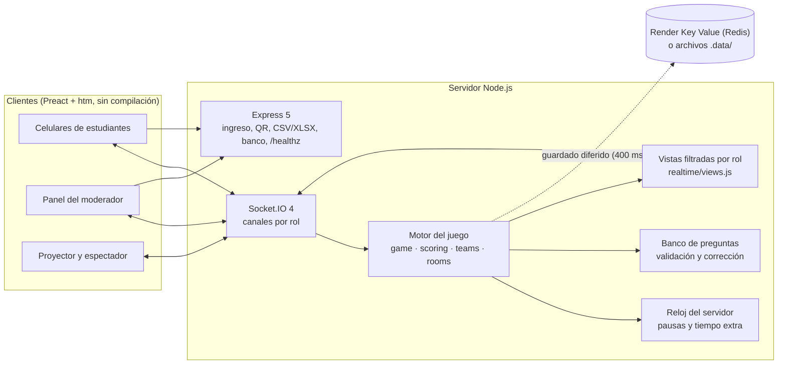

<div align="center">
  
  <h1>Escape Room Estadístico: El Laboratorio Sellado</h1>
  <p><b>Actividad gamificada en tiempo real: equipos que abren candados resolviendo problemas de estadística desde el celular</b><br/>Cierre de la exposición de Análisis Cuantitativo de Datos, UNIMINUTO (repositorio TimeQuest)</p>

  
  
  
  
  
  
  <a href="LICENSE"></a>

  <p>
    <a href="docs/GUIA-DE-CLASE.md"><b>Guía de clase</b></a> ·
    <a href="docs/DECISIONES.md"><b>Arquitectura y decisiones</b></a>
  </p>
</div>

<details>
<summary><b>English summary</b></summary>

*Escape Room Estadístico: El Laboratorio Sellado* ("The Sealed Lab") is a real-time classroom game built to close a Quantitative Data Analysis presentation at UNIMINUTO (Colombia). Students join from their phones with a room code, are split into balanced teams of up to five, and each team tries to open one of four locks (confidence intervals, hypothesis testing, linear regression and ANOVA) by answering five questions cooperatively: everyone votes live and a rotating captain confirms. The teacher runs everything from a moderator panel while a projector view shows the live board, lock openings and the final podium. Grades on a 0–5 scale combine accuracy and opening order, with deterministic tie-breakers.

It is a modular Node.js monolith: Express 5 for HTTP, Socket.IO 4 with role-filtered channels (correct answers never leave the server before a lock closes), a server-authoritative clock with pauses and extra time, and a Preact + htm frontend served as plain ES modules with no build step. Game state lives in memory and is persisted to Render Key Value (Redis) or local JSON files, so rooms survive restarts and come back paused. It ships with `node:test` unit tests, a question-bank validator and a load-testing script with simulated players, and deploys to Render with a Blueprint.
</details>

## Qué es

Una actividad de cierre para repasar estimación, pruebas de hipótesis, regresión lineal y ANOVA. Los estudiantes entran desde el celular con un código, se agrupan en equipos de hasta 5 y cada equipo intenta abrir uno de los cuatro candados respondiendo 5 preguntas en cooperación. El moderador controla todo desde un panel y el proyector muestra el tablero en vivo, los candados que se abren y el podio.

Los cuatro candados siguen la propuesta análoga de la exposición:

1. **El ladrón de datos**: intervalos de confianza (el código es el límite superior del IC).
2. **El juicio**: prueba de hipótesis sobre las baterías de 20 h, culpable/inocente y errores tipo I y II.
3. **Traza la recta**: regresión lineal (el código es el R²).
4. **Tres pociones**: ANOVA (ordenar sumas de cuadrados; el código son los gl del error).

## Pantallas

| Pantalla | Ruta | Quién la usa |
| --- | --- | --- |
| Estudiante | `/` (o `/?sala=CÓDIGO` desde el QR) | Cada estudiante en su celular |
| Panel del moderador | `/moderador` | Docente (pide la clave) |
| Proyector | `/proyector?sala=CÓDIGO` | Pantalla del salón |
| Ranking en vivo (espectador) | `/espectador?sala=CÓDIGO` | Docente o invitados con la clave: puntajes y notas provisionales en vivo |
| Informe imprimible / PDF | `/informe?sala=CÓDIGO` | Docente, después de la partida |
| Certificado | `/certificado` (se abre desde la pantalla final del estudiante) | Cada estudiante |

## Funcionalidades

| Área | Qué incluye |
| --- | --- |
| Equipos | Armado al azar en equipos parejos (23 estudiantes quedan en 5-5-5-4-4), candados en rotación, ajustes manuales y asignación automática de quien llega tarde |
| Cooperación | Votos visibles en vivo, capitán rotativo que confirma, traspaso si se desconecta y *tomar el mando* tras 30 s sin confirmar |
| Tiempo | Reloj del servidor con cuenta regresiva común, pausa global y tiempo extra por candado o para todos |
| Retroalimentación | Modos *instantánea*, *veredicto* (por defecto) o *al final*; revisión con explicaciones al cerrar el candado |
| Proyector | Código y QR de ingreso, progreso de cada candado, anuncio de aperturas, podio con suspenso y minuto de debate sobre la pregunta más difícil |
| Moderador | Panel con secciones Sala, En vivo, Resultados, Preguntas y Ajustes; editor del banco de preguntas con validación, importación y exportación en JSON |
| Resultados | CSV por equipo y por estudiante (listos para Excel en español), libro Excel (.xlsx) con resumen, ranking, notas y preguntas, informe imprimible y certificado individual con insignias |
| Robustez | Reconexión automática de los celulares, salas que sobreviven a reinicios (vuelven en pausa), límite de ritmo por socket y votos idempotentes |

## Puntuación

La nota de cada equipo va de 0 a 5:

$$\text{Nota} = w_A \cdot \frac{\text{Aciertos}}{20} + w_V \cdot \text{Velocidad}$$

* **Aciertos:** 20 puntos por pregunta correcta (máximo 100). Dividido entre 20 queda en escala de 0 a 5.
* **Velocidad:**
  * por orden de apertura: 1.º 5.0, 2.º 4.5, 3.º 4.0, 4.º 3.5;
  * del 5.º en adelante baja 0.5 por puesto, con piso de 3.0;
  * si el tiempo se agota sin abrir el candado: 2.5.
* **Pesos por defecto:** $w_A = 0.7$, $w_V = 0.3$. Se ajustan en Configuración, que muestra una vista previa con escenarios.
* **Desempates, en orden:**
  1. más aciertos;
  2. haber abierto el candado;
  3. menor tiempo;
  4. orden de apertura decidido por el servidor;
  5. más preguntas respondidas;
  6. orden alfabético.

El orden de apertura lo decide el servidor, que procesa las confirmaciones una a una. Por eso nunca hay dos equipos con el mismo puesto, aunque confirmen en el mismo milisegundo.

## Arquitectura

Monolito modular en Node.js: un solo servicio entrega la interfaz, la API HTTP y los WebSockets. Para 30 a 50 conexiones simultáneas no hace falta más, y así se despliega como un único Web Service en Render.



Decisiones técnicas principales (detalle en [`docs/DECISIONES.md`](docs/DECISIONES.md)):

- **El servidor es la autoridad.** Node procesa un evento a la vez y cada voto o confirmación se aplica de forma síncrona; el orden de apertura lo asigna un contador del servidor, así que no hay empates ni carreras, y el reloj del cliente no influye.
- **Las respuestas no salen del servidor antes de tiempo.** Las vistas por rol (público, equipo, jugador, moderador) nunca incluyen la respuesta correcta de una pregunta abierta, y las opciones se barajan distinto para cada equipo.
- **Estado en memoria con respaldo.** Cada cambio se guarda con un retraso corto en Redis o en `.data/rooms/CÓDIGO.json`; si el proceso se reinicia, las salas en juego vuelven en pausa.
- **Reloj sincronizado.** El servidor guarda inicio, pausas y tiempo extra por candado; los clientes solo dibujan la cuenta regresiva y corrigen su desfase con un ping estilo NTP.
- **Sesiones por token.** Cada estudiante recibe un token aleatorio guardado en su navegador (el servidor solo guarda el hash) y se reconecta solo tras recargar o perder la red.
- **Sin paso de compilación.** La interfaz son módulos ES servidos tal cual, de modo que `npm start` es todo lo que hay que ejecutar.

## Stack tecnológico

| Capa | Tecnología |
|---|---|
| Servidor | Node.js 20+ (módulos ES), Express 5 |
| Tiempo real | Socket.IO 4 |
| Interfaz | Preact 11 + htm, sin bundler; tipografía Lato (`@fontsource/lato`) |
| Persistencia | ioredis contra Render Key Value, o archivos JSON locales |
| Exportaciones | CSV con BOM UTF-8 y separador `;`, exceljs (.xlsx), códigos QR con `qrcode` |
| Pruebas | `node:test`, script de carga con `socket.io-client` |
| Despliegue | Render (Web Service + Key Value) mediante Blueprint |

## Puesta en marcha

Requisitos: **Node.js 20 o superior** (probado con Node 22).

```bash
npm install
npm run dev        # recarga automática al editar; o "npm start"
```

Abre <http://localhost:3000/moderador>. Define la clave del panel en la variable `MODERATOR_KEY` (puedes copiar [`.env.example`](.env.example) como `.env` y arrancar con `node --env-file=.env src/server.js`). En desarrollo, si no la defines, se usa una clave por defecto de `src/config.js`; en producción la variable es obligatoria y el servidor no arranca sin ella.

Para probar con celulares reales en la misma red Wi-Fi, sigue los pasos de la [guía de clase](docs/GUIA-DE-CLASE.md#8-probar-con-celulares-reales-en-la-misma-red-wi-fi).

### Variables de entorno

Todas son opcionales en local; en producción solo `MODERATOR_KEY` es obligatoria.

| Variable | Para qué sirve | Por defecto |
| --- | --- | --- |
| `MODERATOR_KEY` | Clave del panel del moderador, las exportaciones y el editor del banco | Obligatoria en producción |
| `PORT` | Puerto HTTP | `3000` (Render lo define solo) |
| `REDIS_URL` | Guarda las salas en Render Key Value | Vacío: archivos en `.data/` |
| `DATA_DIR` | Carpeta de los archivos cuando no hay Redis | `.data` |
| `PUBLIC_URL` | URL base del QR y del enlace de ingreso | En Render usa `RENDER_EXTERNAL_URL` |
| `ROOM_TTL_HOURS` | Horas que se conserva una sala sin actividad | `12` |
| `QUESTIONS_FILE` | Banco de preguntas inicial | `data/questions.json` |
| `MAX_PLAYERS_PER_ROOM` | Tope de jugadores por sala | `80` |

## Pruebas

```bash
npm test                      # pruebas con node:test: puntuación, desempates, ranking en vivo, motor del juego, banco, respuestas y exportaciones
npm run validate:questions    # valida data/questions.json (o: npm run validate:questions -- otra-ruta.json)
npm run load-test             # simula 40 estudiantes contra http://localhost:3000
```

Opciones de la prueba de carga (`node scripts/load-test.js --opción valor`):

| Opción | Qué hace | Por defecto |
| --- | --- | --- |
| `--url` | Servidor a probar (sirve también con la URL de Render) | `http://localhost:3000` |
| `--players` | Número de estudiantes simulados | `40` |
| `--key` | Clave del moderador | `MODERATOR_KEY` o la clave de desarrollo |
| `--think` | Milisegundos que "piensa" cada bot antes de votar | `1500` |
| `--minutes` | Límite de tiempo por candado | `3` |
| `--chaos` | Fracción de jugadores que se desconectan y reconectan a mitad de partida | `0.1` |
| `--keep` | No borra la sala al terminar (para revisar resultados y exportaciones) | apagado |
| `--room CÓDIGO` | **Modo ensayo**: los bots entran a una sala que ya creaste y esperan a que pulses *Iniciar* desde el panel | — |

La prueba reporta latencias p50, p95 y p99 de ingreso, voto y confirmación, los errores y el ranking, y verifica que el orden de apertura sea 1..n sin repetidos. Termina con código 1 si la confirmación p95 supera 1 s o hubo errores de conexión. En una corrida de referencia en un portátil, con 40 jugadores, el voto tuvo p95 de 6 ms y la confirmación p95 de 3 ms; con 50 jugadores y 20 % de desconexiones forzadas no hubo errores.

Antes de una clase conviene recorrer la [lista de pruebas manuales](docs/GUIA-DE-CLASE.md#10-lista-de-pruebas-manuales).

## Despliegue

El repositorio incluye [`render.yaml`](render.yaml) (Blueprint), que crea dos recursos en la región Virginia:

* **`escape-room-estadistico`**: Web Service de Node.
  * Build: `npm ci --omit=dev`
  * Start: `npm start`
  * Health check: `/healthz`
  * Despliegue automático en cada commit a la rama conectada.
* **`escape-room-kv`**: Key Value (compatible con Redis, política `noeviction`) para que las partidas sobrevivan a reinicios y despliegues. Solo es accesible desde la red privada de Render y su `REDIS_URL` se inyecta sola.

Pasos:

1. En el [Dashboard de Render](https://dashboard.render.com): **New → Blueprint**, conecta el repositorio y confirma.
2. Render pedirá el valor de **`MODERATOR_KEY`**. Usa una clave propia de al menos 6 caracteres.
3. Al terminar el despliegue, abre `https://<tu-servicio>.onrender.com/healthz`. Debe responder `{"ok":true,...}` e indicar `"store":"redis"`.
4. Entra a `https://<tu-servicio>.onrender.com/moderador` con tu clave.

**Sin Blueprint (manual):** crea un *Web Service* con runtime Node, los comandos de build y start de arriba, health check `/healthz` y las variables `NODE_ENV=production` y `MODERATOR_KEY`. Si además creas un Key Value, copia su *Internal Connection String* en la variable `REDIS_URL`. Sin `REDIS_URL` la app funciona igual, pero guarda en disco, y el disco de Render se borra en cada reinicio o despliegue.

El estado vive en memoria del proceso, así que el servicio debe correr con **una sola instancia**. Las recomendaciones para el plan gratuito (arranque en frío, ping de mantenimiento, plan del día de la clase) están en la [guía de clase](docs/GUIA-DE-CLASE.md#1-preparar-el-servicio-en-render).

## Estructura del repositorio

```
src/
  server.js, app.js, config.js      Arranque, rutas HTTP (ingreso, QR, exportaciones, salud) y configuración
  modules/
    game/gameEngine.js              Reglas: inicio, votos, capitán, confirmación, tiempo, fin
    scoring/                        Nota, desempates e insignias
    rooms/, teams/                  Salas, jugadores, armado de equipos
    questions/                      Banco de preguntas, validación y corrección de respuestas
    timer/clock.js                  Reloj del servidor con pausas y tiempo extra
    realtime/                       Socket.IO y vistas filtradas por rol (nunca envían respuestas antes de tiempo)
    persistence/                    Guardado en Redis (Key Value) o en archivos
    exports/                        CSV y Excel
public/                             Interfaz (Preact + htm, sin paso de compilación)
data/questions.json                 Banco de preguntas
scripts/                            Validador del banco y prueba de carga
tests/                              Pruebas con node:test
docs/DECISIONES.md                  Arquitectura y decisiones
docs/GUIA-DE-CLASE.md               Guía operativa para el docente
```

## Autoría

<table>
  <tr>
    <td align="center"><a href="https://github.com/Joan-Mora"><br/><b>Darwin Joan Aveiga Mora</b></a><br/><sub>Diseño y desarrollo de la aplicación</sub></td>
  </tr>
</table>

Proyecto académico de la asignatura Análisis Cuantitativo de Datos, UNIMINUTO.

## Licencia

Copyright © 2026 Darwin Joan Aveiga Mora. **Todos los derechos reservados.**

Este repositorio es público para que el código pueda consultarse como parte de mi portafolio. Eso no concede permiso para copiarlo, reutilizarlo, modificarlo, distribuirlo ni presentarlo como trabajo propio. Los términos completos están en [`LICENSE`](LICENSE). Para cualquier uso, escribe a [darwin@abacore.co](mailto:darwin@abacore.co).

<div align="center">
<sub>Hecho por <a href="https://github.com/Joan-Mora">Darwin Aveiga</a> · <a href="https://abacore.co">Abacore S.A.S.</a></sub>
</div>
