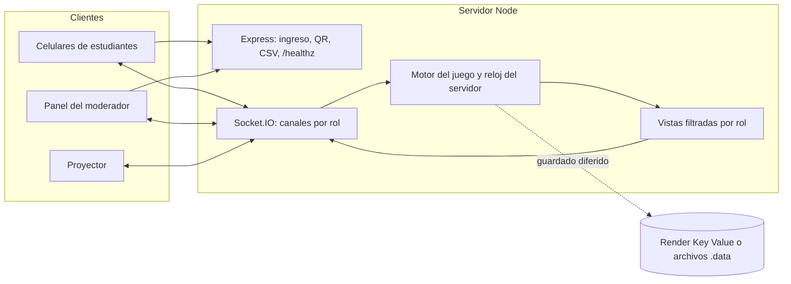

# Arquitectura y decisiones

Este documento explica cómo está construida la aplicación y qué se decidió en cada punto que la especificación dejaba abierto, para que puedas revisarlo y cambiar lo que no te convenza. Cada decisión indica **dónde se cambia**.

## 1. Arquitectura

Es un **monolito modular** en Node.js: un solo servicio sirve la interfaz, la API HTTP y los WebSockets. Para 30–50 conexiones simultáneas no hace falta más, y así se despliega como un único Web Service en Render.

* **Tecnologías**:
  * servidor: Express 5 y Socket.IO 4;
  * interfaz: Preact + htm, módulos ES servidos tal cual, sin paso de compilación, así que `npm start` es todo lo que hay que ejecutar.
* **Estado en memoria, respaldo en Key Value.** La partida vive en memoria del proceso y cada cambio se guarda con un pequeño retraso (400 ms) en Redis o en `.data/rooms/CÓDIGO.json`. Si el proceso se reinicia, las salas se recargan; las que estaban en juego vuelven **en pausa** para que nadie pierda tiempo mientras los celulares se reconectan.
* **El servidor es la autoridad.** Node procesa un evento a la vez y cada voto o confirmación se aplica de forma síncrona. El orden de apertura (1.º, 2.º, …) lo asigna un contador del servidor en el instante en que se procesa la última confirmación. No puede haber empates ni carreras, y el reloj del cliente no influye.
* **Reloj del servidor.** El servidor guarda el inicio, las pausas acumuladas y el tiempo extra por candado. Los clientes solo dibujan la cuenta regresiva, sincronizando su desfase con un ping estilo NTP. Un temporizador de 250 ms cierra los candados que se quedan sin tiempo.
* **Canales y vistas por rol.** Cada rol recibe solo lo suyo:
  * público (proyector y todos);
  * equipo (preguntas y votos del propio equipo);
  * jugador;
  * moderador.

  Las vistas se construyen en `src/modules/realtime/views.js` y **nunca incluyen la respuesta correcta** de una pregunta que no se ha cerrado. Las opciones además se barajan distinto para cada equipo, así que "es la C" no sirve para otro equipo.
* **Sesiones.** Al entrar, el estudiante recibe un token aleatorio que se guarda en su navegador; el servidor solo guarda su hash. Con ese token se reconecta automáticamente tras recargar, perder la red o bloquear el celular.
* **Moderador.** Una clave única (`MODERATOR_KEY`) protege el panel, las exportaciones y el editor del banco. El navegador la recuerda para abrir el informe en otra pestaña sin volver a escribirla.

Módulos (`src/modules/`): `game` (reglas), `scoring` (nota, desempates, insignias), `rooms` y `teams`, `questions` (banco, validación, corrección), `timer`, `realtime`, `persistence`, `exports`.

## 2. Ambigüedades resueltas

### Equipos y candados

| Tema | Decisión | Por qué | Dónde se cambia |
| --- | --- | --- | --- |
| Tamaño de equipo cuando no da exacto | Equipos de hasta 5, lo más parejos posible (23 → 5-5-5-4-4). Nunca quedan equipos de 1 o 2 si hay 6 o más estudiantes. | Un equipo de 2 contra uno de 5 no es justo, y uno de 6 deja gente sin tocar el celular. | Configuración → tamaño o número de equipos |
| Candado de cada equipo | Rotación 1-2-3-4-1…; el moderador puede cambiarlo por equipo. | Con 8 equipos quedan 2 por candado, así la comparación es pareja. | Sección Sala |
| Estudiantes que llegan tarde | Se asignan solos al equipo con menos integrantes, incluso con la partida en curso. | El profesor no tiene que detenerse a acomodarlos. | Configuración → asignación automática de tardíos |
| Equipos vacíos al iniciar | Se eliminan al pulsar Iniciar. | Evita candados "fantasma" que nunca se cierran. | — |
| Cómo coopera el equipo | Todos votan desde su celular y ven los votos de los demás en vivo. Un **capitán rotativo** confirma. En numéricas, cada quien propone un valor y los demás pueden apoyarlo con un toque. | Todos participan, pero la respuesta final es una sola y no hay "gana el más rápido". La rotación reparte el protagonismo. | `gameEngine.js` |
| Capitán desconectado o distraído | Si está desconectado, pasa al siguiente conectado. Si lleva 30 s sin confirmar, cualquier integrante puede **tomar el mando** de esa pregunta. | Un celular olvidado en la mesa no puede trabar a todo el equipo. | `CLAIM_AFTER_MS` en `gameEngine.js` |

### Tiempo

| Tema | Decisión | Por qué | Dónde se cambia |
| --- | --- | --- | --- |
| Tiempo por candado | 8 minutos por defecto, configurable por candado (30 s a 60 min). | 5 preguntas con cálculos en grupo caben en 8 min sin que sobre mucho. | Configuración |
| Pausa | Congela todos los relojes; nadie puede votar durante la pausa. | Justo para todos si hay que explicar algo o se cae la red. | — |
| Tiempo extra | +30 s / +1 min / −30 s, por candado o para todos, en cualquier momento. | Para compensar un problema técnico de un equipo sin afectar a los demás. | Sección En vivo |
| Fin de la partida | Termina sola cuando todos los candados se cierran, abiertos o por tiempo. El moderador puede terminarla antes. | No hay que estar pendiente de un botón. | — |

### Puntuación y retroalimentación

| Tema | Decisión | Por qué | Dónde se cambia |
| --- | --- | --- | --- |
| Fórmula combinada | Nota = 0.7 × (aciertos/20) + 0.3 × velocidad, en escala 0–5. | Es la escala de notas de la universidad. Con 70/30, entre equipos que abren su candado, una respuesta correcta más (+0.7) pesa más que toda la diferencia de velocidad (máximo 0.6), así que el acierto manda y la velocidad desempata. | Configuración → pesos (con vista previa de escenarios) |
| Velocidad del 5.º equipo en adelante | Baja 0.5 por puesto desde 3.5, con piso de 3.0. | Con 8 equipos la tabla original de 4 valores no alcanza. | Configuración → tabla, paso y piso |
| Candado cerrado por tiempo | Velocidad 2.5 (menos que cualquier apertura) y las preguntas sin responder cuentan como incorrectas. | Abrir siempre debe valer más que no abrir. | Configuración → velocidad por tiempo agotado |
| Desempates | 1) más aciertos, 2) haber abierto, 3) menor tiempo, 4) orden de apertura, 5) más respuestas, 6) alfabético. | Primero el conocimiento, luego la eficiencia. El último criterio garantiza un orden determinista. | `scoring.js` |
| Retroalimentación durante el juego | **Veredicto** por defecto: el equipo ve si acertó o falló cada pregunta, pero la explicación y la respuesta correcta llegan al cerrar su candado. | Da emoción sin regalar respuestas a otros equipos del mismo candado mientras juegan. | Configuración: *instantánea* (explicación inmediata), *veredicto* o *al final* (sin pistas) |
| Aciertos en el proyector | Ocultos hasta el podio; el proyector muestra solo el progreso y el orden de apertura. | Mantiene el suspenso hasta el final: "¿quién escapó mejor?". | Configuración → mostrar aciertos en vivo |
| Podio | Lo revela el moderador con un botón, del 3.º al 1.º con sonido y confeti. | El profesor elige el momento dramático. | — |
| Ranking en vivo | Vista aparte, `/espectador`, protegida con la clave del moderador y de solo lectura. El proyector sigue ocultando los aciertos. | El docente sigue los puntajes sin que los estudiantes vean el ranking y se pierda el suspenso del podio. No expone respuestas. | — |
| Nota provisional de quien sigue jugando | Aciertos actuales (lo no respondido cuenta como no acertado) + la velocidad del siguiente puesto libre, como si abriera ahora. Se muestra también el **techo**. | Es la lectura más honesta del "si terminara ya", y el techo muestra quién todavía puede remontar. Al cerrarse todos los candados coincide exactamente con el resultado final (hay una prueba automática). | `liveRanking` en `gameEngine.js` |

### Operación

| Tema | Decisión | Por qué | Dónde se cambia |
| --- | --- | --- | --- |
| Selección de preguntas | Las 5 primeras activas de cada candado, en orden barajado por equipo. Hay 2 de reserva por candado. | Todos los equipos del mismo candado responden lo mismo, lo cual es justo, pero no en el mismo orden. | Sección Preguntas o `data/questions.json` |
| Edición del banco | Desde el panel, con validación. Aplica a partidas nuevas, nunca a la que está en curso. | Corregir un typo cinco minutos antes de la clase sin tocar código. | Sección Preguntas |
| PDF | Informe imprimible en `/informe` → "Guardar como PDF" del navegador. | Evita una librería pesada de PDF en el servidor y queda con el mismo estilo visual. | — |
| CSV | Separador `;`, coma decimal y BOM UTF-8. | Excel en español lo abre directamente con tildes y números correctos. | `exportService.js` |
| Persistencia | Redis (Render Key Value) si existe `REDIS_URL`; si no, archivos locales. Las salas expiran a las 12 h sin actividad. | Es persistencia mínima pero suficiente para sobrevivir a un reinicio en plena clase. | `ROOM_TTL_HOURS` |

## 3. Mejoras que agregué además de lo pedido

**Diversión**
* Votos visibles como avatares sobre cada opción y aviso al capitán si va contra la mayoría.
* Sonidos y vibración al acertar, fallar y abrir (se pueden silenciar).
* XP y "vidas" cosméticas en la cabecera.
* Insignias: por candado, *Llave maestra*, *Pleno estadístico*, *Racha imparable*, *Equipo sincronizado* y *Escape de último segundo*.
* Suspenso en el proyector antes del podio, y un minuto de debate con las preguntas que más costaron.

**Equidad**
* Opciones barajadas por equipo.
* Orden de apertura decidido por el servidor.
* Capitán rotativo y *tomar el mando* tras 30 s.
* Tiempo extra por candado.
* Tamaños de equipo parejos.
* Desempates explícitos, visibles en la tabla final.

**Facilidad de operación**
* Botón principal único (Iniciar → Pausar → Reanudar → Revelar podio) con confirmación al iniciar y 1.5 s de bloqueo tras cada cambio, para que un doble clic no inicie y pause a la vez.
* QR en el proyector.
* Reconexión automática de estudiantes, y restauración en pausa si el servidor se reinicia.
* Ping de mantenimiento desde el panel y el proyector para que Render no se duerma durante la clase.
* **Modo ensayo** con bots (`load-test --room`) para practicar la clase completa.
* Editor del banco en el panel.
* Validador del banco (`npm run validate:questions`).

**Robustez en celulares**
* Diseñado y verificado a 320 px y 360 px de ancho, sin desplazamiento horizontal ni contenido cortado. En pantallas pequeñas la etiqueta del candado se abrevia ("C3 · Regresión") y las opciones se compactan.
* Botones sin retraso de doble toque (`touch-action: manipulation`) y campos con letra de 16 px o más, para que el iPhone no haga zoom al escribir.
* Tras cambiar de pregunta se ignoran los toques durante 0.7 s, para que un toque destinado a la pregunta anterior no vote en la nueva.
* Votos idempotentes y confirmación protegida contra doble envío.
* Límite de ritmo por socket.

## 4. Seguridad y límites conocidos

* Las respuestas correctas **no salen del servidor** hasta que el candado del equipo se cierra (o tras cada pregunta en modo *instantánea*). Puedes comprobarlo en la pestaña Red del navegador.
* La clave del moderador es una sola y viaja en cada petición del panel por HTTPS (en Render). Es adecuada para una clase, no para datos sensibles.
* Un estudiante que cambia de celular entra como un jugador nuevo ("Nombre (2)"). Su equipo no pierde progreso, pero sus estadísticas individuales empiezan de cero. El moderador puede moverlo a su equipo y expulsar la sesión vieja.
* En modo *veredicto*, un equipo que ya cerró su candado podría contarle las respuestas a otro equipo del mismo candado que aún juega. Si eso preocupa, usa el modo *al final*.
* **Una sola instancia.** El estado vive en memoria; escalar horizontalmente requeriría mover el estado a Redis por completo y usar el adaptador de Socket.IO.
* El Key Value gratuito de Render no persiste en disco. Un reinicio del propio Key Value (poco frecuente) borraría las salas.
